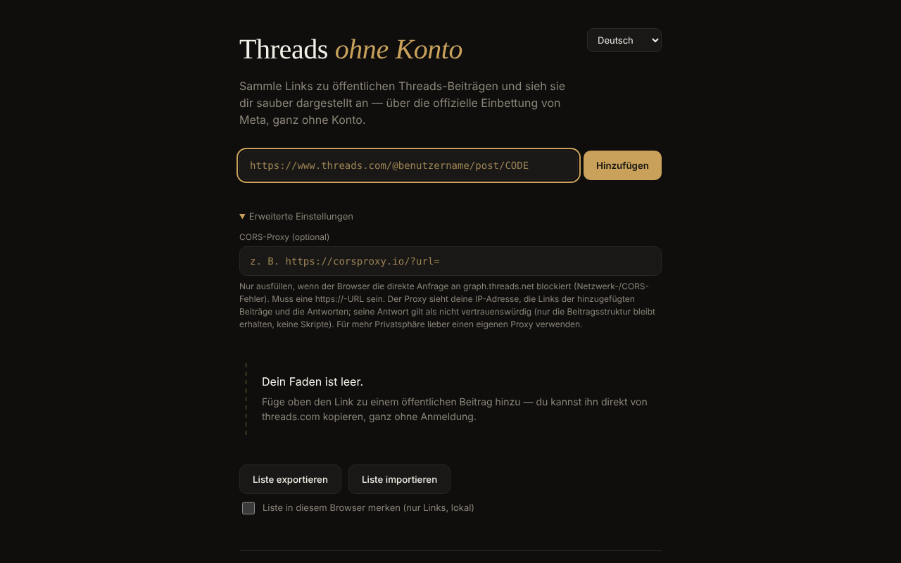

# Threads fără cont

[English](README.md) · [Română](README.ro.md) · [Français](README.fr.md) · [Italiano](README.it.md) · [Español](README.es.md) · [Português](README.pt.md) · **Deutsch** · [Magyar](README.hu.md)

**Version:** 2.1.0 · **Zuletzt aktualisiert:** 2026-10-27

Oberflächensprachen: **Română, English, Français, Italiano, Español, Português (PT), Deutsch, Magyar**

Betrachter für öffentliche Threads-Beiträge in einer einzigen HTML-Datei: Sie fügen einzelne Links hinzu und sehen sie über das offizielle Embed von Meta dargestellt, ohne Konto, in 8 Sprachen.

**Online-Anwendung:** https://chiuta.github.io/Threads-fara-cont/

## Was es ist

Ein „Faden“, von Hand aus Links zu öffentlichen Threads-Beiträgen aufgebaut. Die Anwendung fragt den Beitrag bei der oEmbed-API von Meta (`graph.threads.net/v1.0/oembed`) an und zeigt ihn in der Seite an. Die Oberfläche gibt es auf Rumänisch, Englisch, Französisch, Italienisch, Spanisch, Portugiesisch, Deutsch und Ungarisch. Es ist ein persönliches, inoffizielles Projekt ohne Verbindung zu Meta.

## Funktionen

- Hinzufügen von Beiträgen per Link (`threads.com` / `threads.net`, in der Form `@benutzer/post/CODE` oder `t/CODE`), mit strenger Validierung und Erkennung von Duplikaten.
- Jede Karte hat eine Schaltfläche zum Entfernen; laufende Anfragen werden beim Entfernen abgebrochen.
- Export der Liste (ein Link pro Zeile, in einem Textfeld) und Import: höchstens 50 Zeilen pro Import, höchstens 100 Beiträge im Faden, Laden mit begrenzter Parallelität; die Reihenfolge der Karten folgt der Reihenfolge der Liste.
- Optionales Feld „CORS-Proxy“: nur `https://`, ohne Benutzername/Passwort; es kann `{url}` enthalten oder bekommt die kodierte oEmbed-URL am Ende angehängt.
- Zeitlimit von 15 Sekunden pro Anfrage, mit unterschiedlichen Fehlermeldungen (CORS/Netzwerk, Zeitüberschreitung, ungültiger Proxy, leere Antwort).
- Die oEmbed-Antwort (und die des Proxys) wird als nicht vertrauenswürdig behandelt: Sie wird in ein inertes Dokument geparst, und es bleibt nur das `blockquote.text-post-media` mit Text und Links zu `threads.net`/`threads.com` erhalten; Skripte, `on*`-Attribute, `style` und `javascript:`-URLs werden entfernt.
- Optionales lokales Speichern („Liste in diesem Browser merken“, standardmäßig aus): Es werden nur die Links in `localStorage` gespeichert; beim nächsten Besuch erscheint die Schaltfläche „Gespeicherte Liste wiederherstellen“, ohne jede Netzwerkanfrage, bis Sie sie drücken. Das Ausschalten löscht die gespeicherte Liste.
- Export: Das Textfeld hat jetzt die Schaltflächen „Kopieren“ und „.txt herunterladen“; fehlgeschlagene Karten haben eine Schaltfläche „Erneut versuchen“, einen Link „Auf Threads öffnen ↗“ und eine „Offline“-Meldung mit automatischem Wiederholen bei erneuter Verbindung; Druckstil (nur der Faden wird gedruckt).
- Sprachauswahl; die Standardsprache stammt aus den Browsereinstellungen.

## Verwendung

1. Öffnen Sie die Seite und wählen Sie bei Bedarf die Sprache in der oberen rechten Ecke.
2. Kopieren Sie den Link eines öffentlichen Beitrags von threads.com.
3. Fügen Sie ihn in das Feld ein und drücken Sie „Hinzufügen“ (oder die Eingabetaste). Der Beitrag erscheint als Karte im Faden.
4. Erscheint ein Netzwerk-/CORS-Fehler, öffnen Sie „Erweiterte Einstellungen“ und tragen Sie einen `https://`-CORS-Proxy ein (am besten einen eigenen).
5. „Liste exportieren“ zeigt die Links in einem Textfeld; kopieren Sie sie in eine Datei. Zum erneuten Laden „Liste importieren“, die Links einfügen und „Import bestätigen“.
6. Drücken Sie × auf einer Karte, um sie zu entfernen.

## Datenschutz und Netzwerk

**Ohne Konto ≠ ohne Tracking.**

- Speicherung: Standardmäßig verwendet die Anwendung weder `localStorage`, `sessionStorage`, Cookies noch IndexedDB; die Liste existiert nur im Speicher des Tabs, und Sie sichern sie selbst über den Export. Nur wenn Sie „Liste in diesem Browser merken“ ankreuzen, werden die Links (nicht der Inhalt der Beiträge) in `localStorage` geschrieben (`tfc_keep`, `tfc_list`) und beim Abwählen gelöscht.
- Kontaktierte Hosts, nur beim Hinzufügen eines Beitrags: `graph.threads.net` (die oEmbed-Anfrage; oder der von Ihnen konfigurierte Proxy) und `www.threads.net` (das Skript `embed.js`, von Meta kontrollierter Drittanbieter-Code, geladen von der im Code festgelegten Adresse, niemals aus der Antwort). `embed.js` erzeugt anschließend iframes zu den Threads-Domains.
- Meta sieht Ihre IP-Adresse, Ihre Browserdaten und die Beiträge, die Sie ansehen. Ein von Ihnen konfigurierter Proxy sieht Ihre IP, die hinzugefügten Links und die Antworten.
- Die Seite enthält eine CSP-Richtlinie (`meta http-equiv`), die Skripte auf das eigene Skript (durch einen SHA-256-Hash identifiziert, ohne `'unsafe-inline'`) und auf `threads.net`/`threads.com` sowie Frames auf die Threads-Domains beschränkt. Die Kompatibilität mit dem echten `embed.js` konnte aus der Entwicklungsumgebung nicht getestet werden (kein Netzwerkzugang).
- Die Anwendung hat keine Analysen und sendet nirgendwohin Daten außer wie oben beschrieben. Sie verlangt keine Browserberechtigungen.

## Grenzen und Hinweise

- Die Aussage, dass Threads-oEmbed seit dem 15. Juni 2026 ohne Token funktioniert, stammt aus der Ankündigung von Meta („Tokenless access to Meta oEmbed APIs“, Entwicklerblog von Meta, 15.06.2026); die alte Dokumentation verlangt weiterhin ein Token, und Grenzen und Bedingungen können abweichen — prüfen Sie die Dokumentation von Meta.
- Die Bedingungen von Meta erlauben das Embed nur zur Anzeige; die Anwendung extrahiert und speichert den Inhalt der Beiträge nicht.
- Sie kann die Beiträge eines Profils nicht automatisch auflisten (Meta bietet dafür keine öffentliche API).
- Wenn Sie die Seite mit Beiträgen im Faden schließen oder neu laden, fragt der Browser nach einer Bestätigung (die Liste wird nur gespeichert, wenn Sie das lokale Speichern angekreuzt haben; sonst nutzen Sie „Liste exportieren“).
- Private, altersbeschränkte oder geogeblockte Beiträge werden nicht angezeigt.
- Der Browser kann die direkte Anfrage blockieren (CORS); dann ist ein Proxy nötig, mit den oben genannten Datenschutzfolgen.
- Wenn Sie auf illegale oder schädliche Inhalte stoßen, melden Sie sie Meta; die Anwendung moderiert nichts.

## Lokal / offline ausführen

Laden Sie `index.html` herunter und öffnen Sie sie in einem Browser. Ohne Internet kann kein Beitrag geladen werden (die Anwendung existiert für Inhalte aus dem Internet); die Oberfläche, die Validierung und der Import/Export funktionieren lokal.

## Verlauf / Changelog

### 1.2.3 — 2026-10-22

fff-kit 1.1.4: Touch-Ziele und Mindestschriftgröße.

### 1.2.2 — 2026-10-22
- fff-kit 1.1.2: PBKDF2 mit 600.000 Iterationen, Schutz vor Clickjacking

### 1.2.1 — 2026-10-22
- Click-to-load für das Fremdskript: Der von Meta geholte Beitragstext erscheint als einfacher Text mit Links; Metas embed.js wird erst nach „Mit dem Meta-Embed anzeigen“ von threads.net geladen.
- Neuer Export „JSON herunterladen“ mit URL, Autor und Hinzufügedatum je Beitrag.
- Mobil: kein Text unter 12 px und Touch-Ziele von mindestens 24 px (WCAG 2.5.8).

### 1.1.0 — 2026-10-14
- Sicherungskopie und Datenkennzeichnung (fff-kit).

### 12. Oktober 2026 — Version 1.0.0
- 1.0.0 — 2026-10-12: Version und Datum der letzten Aktualisierung werden in der Anwendung angezeigt

### 11. Oktober 2026 (dritter Durchgang)
- Fehlgeschlagene Karten: eigene Meldung „Sie sind offline“ (wenn der Browser fehlende Verbindung meldet, in 7 Sprachen), automatisches Wiederholen bei erneuter Verbindung und der Link „Auf Threads öffnen ↗“ zum ursprünglichen Beitrag (wird nur per Klick geöffnet), damit sie auch ohne Embed nützlich bleibt. CSP: Hash neu berechnet.

### 11. Oktober 2026 (zweiter Durchgang)
- Optionales lokales Speichern der Linkliste (standardmäßig aus) mit Wiederherstellung auf Anforderung; Export mit „Kopieren“/„.txt herunterladen“; „Erneut versuchen“ bei fehlgeschlagenen Karten; Druckstil; neue Texte in allen 7 Sprachen. CSP: Hash des Skripts neu berechnet.

### 11. Oktober 2026
- Barrierefreiheit: Der Inhalt ist in `<main>` eingefasst; axe-core meldet 0 Verstöße bei 1280 und 360 px.
- Die Liste geht nicht mehr unerwartet verloren: Beim Schließen/Neuladen des Tabs mit Beiträgen im Faden fragt der Browser nach einer Bestätigung.
- CSP: `script-src` verwendet einen SHA-256-Hash statt `'unsafe-inline'`.
- README: Die Ankündigung von Meta zu oEmbed ohne Token (15.06.2026) wurde erneut bestätigt.

**Am 11.10.2026 geprüfte Quellen:** developers.facebook.com — „Tokenless access to Meta oEmbed APIs“ (15.06.2026): Threads-oEmbed ohne Token, Grenzen möglicherweise abweichend.

## Lizenz

MIT — siehe die Datei `LICENSE`.

## Autor

Alexio — Alexandru-Ionuț Chiuță, Kontakt: alexio@trom.tf

## Zusammenfassung

Threads fără cont („Threads ohne Konto“) ist ein Einzeldatei-Betrachter für öffentliche Threads-Beiträge, in 8 Sprachen. Sie fügen Links einzelner Beiträge ein; er ruft das oEmbed von Meta ab (optional über Ihren eigenen HTTPS-CORS-Proxy) und stellt ein bereinigtes Embed dar. Die oEmbed-Antwort wird nie unverändert eingefügt. Kein Konto, keine Analysen, keine Browser-Speicherung, aber Meta sieht Ihre IP und die Beiträge, die Sie ansehen, und lädt sein eigenes embed.js. Lizenz: MIT (siehe LICENSE).
