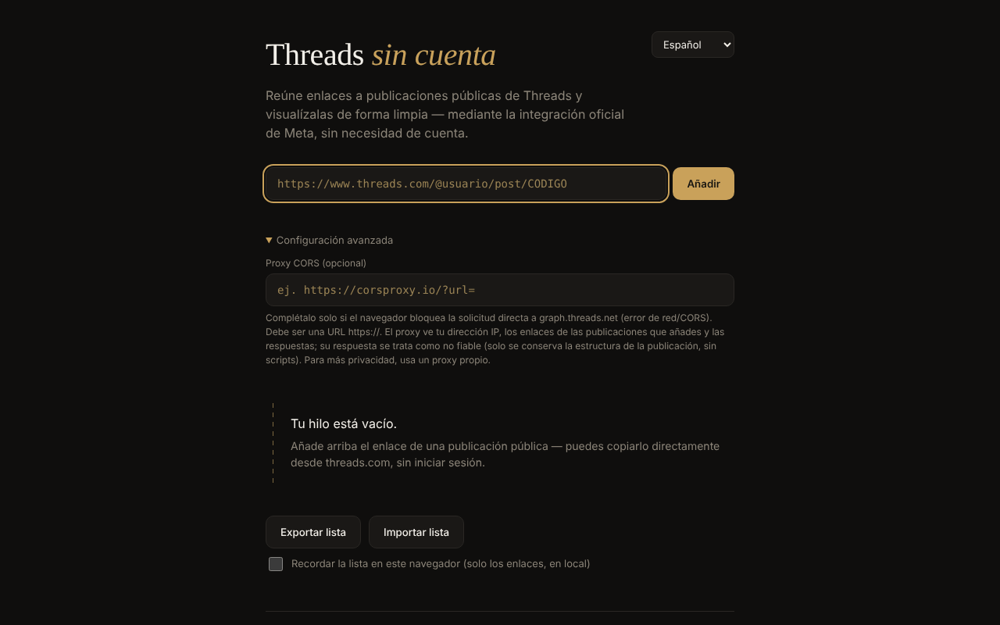

# Threads fără cont

[English](README.md) · [Română](README.ro.md) · [Français](README.fr.md) · [Italiano](README.it.md) · **Español** · [Português](README.pt.md) · [Deutsch](README.de.md) · [Magyar](README.hu.md)

**Versión:** 1.2.2 · **Última actualización:** 2026-10-22

Idiomas de la interfaz: **Română, English, Français, Italiano, Español, Português (PT), Deutsch, Magyar**

Visor de publicaciones públicas de Threads en un único archivo HTML: añades enlaces individuales y los ves mostrados mediante el embed oficial de Meta, sin cuenta, en 8 idiomas.

**Aplicación en línea:** https://chiuta.github.io/Threads-fara-cont/

## Qué es

Un «hilo» construido a mano a partir de enlaces a publicaciones públicas de Threads. La aplicación solicita la publicación a la API oEmbed de Meta (`graph.threads.net/v1.0/oembed`) y la muestra en la página. La interfaz existe en rumano, inglés, francés, italiano, español, portugués, alemán y húngaro. Es un proyecto personal, no oficial, sin relación con Meta.

## Funciones

- Adición de publicaciones por enlace (`threads.com` / `threads.net`, con la forma `@usuario/post/CÓDIGO` o `t/CÓDIGO`), con validación estricta y detección de duplicados.
- Cada tarjeta tiene un botón de eliminación; las solicitudes en curso se cancelan al eliminarla.
- Exportación de la lista (un enlace por línea, en un área de texto) e importación: como máximo 50 líneas por importación, como máximo 100 publicaciones en el hilo, carga con concurrencia limitada; el orden de las tarjetas respeta el de la lista.
- Campo opcional «Proxy CORS»: solo `https://`, sin usuario/contraseña; puede contener `{url}` o recibe al final la URL oEmbed codificada.
- Tiempo de espera de 15 segundos por solicitud, con mensajes de error distintos (CORS/red, tiempo agotado, proxy no válido, respuesta vacía).
- La respuesta oEmbed (y la del proxy) se trata como no fiable: se analiza en un documento inerte y solo se conserva el `blockquote.text-post-media` con texto y enlaces a `threads.net`/`threads.com`; se eliminan los scripts, los atributos `on*`, `style` y las URL `javascript:`.
- Guardado local opcional («Recordar la lista en este navegador», desactivado por defecto): solo se conservan los enlaces, en `localStorage`; en la siguiente visita aparece el botón «Restaurar la lista guardada», sin ninguna solicitud de red hasta que lo pulses. Al desactivarlo se borra la lista guardada.
- Exportación: el área de texto tiene ahora botones «Copiar» y «Descargar .txt»; las tarjetas fallidas tienen un botón «Reintentar», un enlace «Abrir en Threads ↗» y un mensaje «sin conexión» con reintento automático al reconectar; estilo de impresión (solo se imprime el hilo).
- Selector de idioma; el idioma predeterminado procede de los ajustes del navegador.

## Cómo se usa

1. Abre la página y, si quieres, elige el idioma en la esquina superior derecha.
2. Copia el enlace de una publicación pública de threads.com.
3. Pégalo en el campo y pulsa «Añadir» (o Intro). La publicación aparece como una tarjeta en el hilo.
4. Si aparece un error de red/CORS, abre «Ajustes avanzados» y rellena un proxy CORS `https://` (de preferencia uno propio).
5. «Exportar la lista» muestra los enlaces en un área de texto; cópialos en un archivo. Para volver a cargarlos, «Importar la lista», pega los enlaces y «Confirmar importación».
6. Pulsa × en una tarjeta para eliminarla.

## Privacidad y red

**Sin cuenta ≠ sin rastreo.**

- Almacenamiento: por defecto la aplicación no usa `localStorage`, `sessionStorage`, cookies ni IndexedDB; la lista existe solo en la memoria de la pestaña y la guardas tú mediante la exportación. Solo si marcas «Recordar la lista en este navegador» se escriben los enlaces (no el contenido de las publicaciones) en `localStorage` (`tfc_keep`, `tfc_list`), y se borran al desmarcarlo.
- Hosts contactados, solo al añadir una publicación: `graph.threads.net` (la solicitud oEmbed; o el proxy que configures tú) y `www.threads.net` (el script `embed.js`, código de terceros controlado por Meta, cargado desde la dirección fija del código, nunca desde la respuesta). `embed.js` crea después iframes hacia los dominios de Threads.
- Meta ve tu dirección IP, los datos del navegador y las publicaciones que visualizas. Un proxy configurado por ti ve tu IP, los enlaces añadidos y las respuestas.
- La página contiene una política CSP (`meta http-equiv`) que limita los scripts a su propio script (identificado por un hash SHA-256, sin `'unsafe-inline'`) y a `threads.net`/`threads.com`, y los marcos a los dominios de Threads. La compatibilidad con el `embed.js` real no pudo probarse desde el entorno de desarrollo (sin acceso a la red).
- La aplicación no tiene analítica y no envía datos a ningún sitio aparte de lo anterior. No solicita permisos del navegador.

## Límites y advertencias

- La afirmación de que el oEmbed de Threads funciona sin token desde el 15 de junio de 2026 procede del anuncio de Meta («Tokenless access to Meta oEmbed APIs», blog para desarrolladores de Meta, 15.06.2026); la documentación antigua aún exige un token, y los límites y condiciones pueden diferir — consulta la documentación de Meta.
- Los términos de Meta permiten el embed solo para mostrar contenido; la aplicación no extrae ni conserva el contenido de las publicaciones.
- No puede listar automáticamente las publicaciones de un perfil (Meta no ofrece una API pública para ello).
- Si cierras o recargas la página con publicaciones en el hilo, el navegador pide confirmación (la lista no se guarda salvo que hayas marcado el guardado local; de lo contrario, usa «Exportar la lista»).
- Las publicaciones privadas, con restricción de edad o bloqueadas geográficamente no se muestran.
- El navegador puede bloquear la solicitud directa (CORS); entonces hace falta un proxy, con las implicaciones de privacidad descritas arriba.
- Si encuentras contenido ilegal o dañino, denúncialo a Meta; la aplicación no modera nada.

## Ejecución local / sin conexión

Descarga `index.html` y ábrelo en un navegador. Sin internet no se puede cargar ninguna publicación (la aplicación existe para contenido de internet); la interfaz, la validación y la importación/exportación funcionan en local.

## Historial / Changelog

### 1.2.2 — 2026-10-22
- fff-kit 1.1.2: PBKDF2 con 600.000 iteraciones, protección anti-clickjacking

### 1.2.1 — 2026-10-22
- Click-to-load para el script de terceros: el texto de la publicación obtenido de Meta se muestra como texto y enlaces simples; embed.js de Meta se carga desde threads.net solo tras pulsar «Mostrar con el embed de Meta».
- Nueva exportación «Descargar .json» con URL, autor y fecha de adición de cada publicación.
- Móvil: ningún texto por debajo de 12 px y áreas táctiles de al menos 24 px (WCAG 2.5.8).

### 1.1.0 — 2026-10-14
- Copia de seguridad y etiquetado de datos (fff-kit).

### 12 de octubre de 2026 — versión 1.0.0
- 1.0.0 — 2026-10-12: la versión y la fecha de la última actualización se muestran en la aplicación

### 11 de octubre de 2026 (tercera pasada)
- Tarjetas fallidas: mensaje distinto «estás sin conexión» (cuando el navegador informa de la falta de conexión, en 7 idiomas), reintento automático al reconectar y enlace «Abrir en Threads ↗» a la publicación original (se abre solo al hacer clic), para que siga siendo útil incluso sin el embed. CSP: hash recalculado.

### 11 de octubre de 2026 (segunda pasada)
- Guardado local opcional de la lista de enlaces (desactivado por defecto) con restauración a petición; exportación con «Copiar»/«Descargar .txt»; «Reintentar» en las tarjetas fallidas; estilo de impresión; textos nuevos en los 7 idiomas. CSP: hash del script recalculado.

### 11 de octubre de 2026
- Accesibilidad: el contenido está envuelto en `<main>`; axe-core informa de 0 infracciones a 1280 y 360 px.
- La lista ya no se pierde inesperadamente: al cerrar/recargar la pestaña con publicaciones en el hilo, el navegador pide confirmación.
- CSP: `script-src` usa un hash SHA-256 en lugar de `'unsafe-inline'`.
- README: se reconfirmó el anuncio de Meta sobre oEmbed sin token (15.06.2026).

**Fuentes verificadas el 11.10.2026:** developers.facebook.com — «Tokenless access to Meta oEmbed APIs» (15.06.2026): oEmbed de Threads sin token, límites posiblemente distintos.

## Licencia

MIT — véase el archivo `LICENSE`.

## Autor

Alexio — Alexandru-Ionuț Chiuță, contacto: alexio@trom.tf

## Resumen

Threads fără cont («Threads sin cuenta») es un visor de un único archivo para publicaciones públicas de Threads, en 8 idiomas. Pegas enlaces de publicaciones individuales; obtiene el oEmbed de Meta (opcionalmente mediante tu propio proxy CORS HTTPS) y muestra un embed saneado. La respuesta oEmbed nunca se inyecta tal cual. Sin cuenta, sin analítica, sin almacenamiento en el navegador, pero Meta ve tu IP y las publicaciones que visualizas, y carga su propio embed.js. Licencia: MIT (véase LICENSE).
