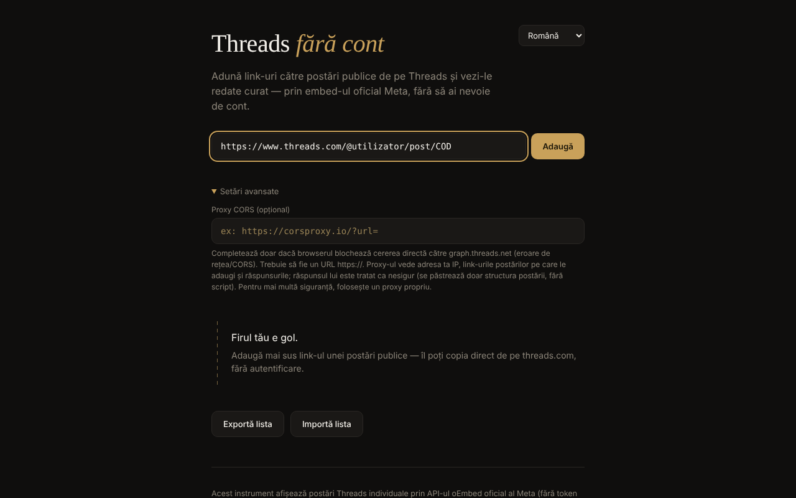

# Threads fără cont

[English](README.md) · [Română](README.ro.md) · **Français** · [Italiano](README.it.md) · [Español](README.es.md) · [Português](README.pt.md) · [Deutsch](README.de.md) · [Magyar](README.hu.md)

**Version :** 1.1.0 · **Dernière mise à jour :** 2026-10-14

Visionneuse de publications Threads publiques dans un seul fichier HTML : vous ajoutez des liens individuels et vous les voyez affichés via l'embed officiel de Meta, sans compte, en 7 langues.

**Application en ligne :** https://chiuta.github.io/Threads-fara-cont/

## De quoi s'agit-il

Un « fil » construit à la main à partir de liens vers des publications Threads publiques. L'application demande la publication à l'API oEmbed de Meta (`graph.threads.net/v1.0/oembed`) et l'affiche dans la page. L'interface existe en roumain, anglais, français, italien, espagnol, portugais et allemand. C'est un projet personnel, non officiel, sans lien avec Meta.

## Fonctions

- Ajout de publications par lien (`threads.com` / `threads.net`, sous la forme `@utilisateur/post/CODE` ou `t/CODE`), avec validation stricte et détection des doublons.
- Chaque carte a un bouton de suppression ; les requêtes en cours sont annulées à la suppression.
- Export de la liste (un lien par ligne, dans une zone de texte) et import : 50 lignes au maximum par import, 100 publications au maximum dans le fil, chargement à concurrence limitée ; l'ordre des cartes respecte l'ordre de la liste.
- Champ facultatif « Proxy CORS » : `https://` uniquement, sans identifiant/mot de passe ; il peut contenir `{url}` ou recevoir l'URL oEmbed encodée à la fin.
- Délai d'attente de 15 secondes par requête, avec des messages d'erreur distincts (CORS/réseau, délai dépassé, proxy invalide, réponse vide).
- La réponse oEmbed (et celle du proxy) est traitée comme non fiable : elle est analysée dans un document inerte et seul le `blockquote.text-post-media` avec texte et liens vers `threads.net`/`threads.com` est conservé ; les scripts, les attributs `on*`, `style` et les URL `javascript:` sont supprimés.
- Enregistrement local facultatif (« Garder la liste dans ce navigateur », désactivé par défaut) : seuls les liens sont conservés, dans `localStorage` ; à la visite suivante, le bouton « Restaurer la liste enregistrée » apparaît, sans aucune requête réseau tant que vous ne l'avez pas pressé. La désactivation supprime la liste enregistrée.
- Export : la zone de texte comporte désormais des boutons « Copier » et « Télécharger .txt » ; les cartes en échec ont un bouton « Réessayer », un lien « Ouvrir sur Threads ↗ » et un message « hors ligne » avec nouvelle tentative automatique à la reconnexion ; style d'impression (seul le fil est imprimé).
- Sélecteur de langue ; la langue par défaut vient des réglages du navigateur.

## Mode d'emploi

1. Ouvrez la page et, si vous le souhaitez, choisissez la langue dans le coin supérieur droit.
2. Copiez le lien d'une publication publique de threads.com.
3. Collez-le dans le champ et appuyez sur « Ajouter » (ou Entrée). La publication apparaît sous forme de carte dans le fil.
4. Si une erreur réseau/CORS apparaît, ouvrez « Paramètres avancés » et renseignez un proxy CORS `https://` (de préférence le vôtre).
5. « Exporter la liste » affiche les liens dans une zone de texte ; copiez-les dans un fichier. Pour les recharger, « Importer la liste », collez les liens et « Confirmer l'import ».
6. Appuyez sur × sur une carte pour la supprimer.

## Confidentialité et réseau

**Sans compte ≠ sans pistage.**

- Stockage : par défaut, l'application n'utilise ni `localStorage`, ni `sessionStorage`, ni cookies, ni IndexedDB ; la liste n'existe que dans la mémoire de l'onglet et vous l'enregistrez vous-même par l'export. Ce n'est que si vous cochez « Garder la liste dans ce navigateur » que les liens (et non le contenu des publications) sont écrits dans `localStorage` (`tfc_keep`, `tfc_list`) ; ils sont effacés à la décoche.
- Hôtes contactés, uniquement lorsque vous ajoutez une publication : `graph.threads.net` (la requête oEmbed ; ou le proxy que vous configurez vous-même) et `www.threads.net` (le script `embed.js`, code tiers contrôlé par Meta, chargé depuis l'adresse fixe du code, jamais depuis la réponse). `embed.js` crée ensuite des iframes vers les domaines Threads.
- Meta voit votre adresse IP, les données de votre navigateur et les publications que vous consultez. Un proxy configuré par vous voit votre IP, les liens ajoutés et les réponses.
- La page contient une politique CSP (`meta http-equiv`) qui limite les scripts à son propre script (identifié par un hash SHA-256, sans `'unsafe-inline'`) et à `threads.net`/`threads.com`, et les cadres aux domaines Threads. La compatibilité avec le véritable `embed.js` n'a pas pu être testée depuis l'environnement de développement (sans accès au réseau).
- L'application n'a aucune analytique et n'envoie de données nulle part en dehors de ce qui précède. Elle ne demande aucune autorisation au navigateur.

## Limites et avertissements

- L'affirmation selon laquelle l'oEmbed de Threads fonctionne sans jeton depuis le 15 juin 2026 provient de l'annonce de Meta (« Tokenless access to Meta oEmbed APIs », blog des développeurs de Meta, 15.06.2026) ; l'ancienne documentation exige encore un jeton, et les limites et conditions peuvent différer — consultez la documentation de Meta.
- Les conditions de Meta n'autorisent l'embed que pour l'affichage ; l'application n'extrait ni ne conserve le contenu des publications.
- Elle ne peut pas lister automatiquement les publications d'un profil (Meta ne fournit pas d'API publique pour cela).
- Si vous fermez ou rechargez la page avec des publications dans le fil, le navigateur demande confirmation (la liste n'est enregistrée que si vous avez coché l'enregistrement local ; sinon utilisez « Exporter la liste »).
- Les publications privées, soumises à une restriction d'âge ou géobloquées ne s'affichent pas.
- Le navigateur peut bloquer la requête directe (CORS) ; un proxy est alors nécessaire, avec les implications de confidentialité ci-dessus.
- Si vous rencontrez un contenu illégal ou nuisible, signalez-le à Meta ; l'application ne modère rien.

## Exécution locale / hors ligne

Téléchargez `index.html` et ouvrez-le dans un navigateur. Sans internet, aucune publication ne peut être chargée (l'application existe pour du contenu d'internet) ; l'interface, la validation et l'import/export fonctionnent localement.

## Historique / Changelog

### 1.1.0 — 2026-10-14
- Sauvegarde et étiquetage des données (fff-kit).

### 12 octobre 2026 — version 1.0.0
- 1.0.0 — 2026-10-12 : la version et la date de dernière mise à jour sont affichées dans l'application

### 11 octobre 2026 (troisième passe)
- Cartes en échec : message distinct « vous êtes hors ligne » (lorsque le navigateur signale l'absence de connexion, dans 7 langues), nouvelle tentative automatique à la reconnexion et lien « Ouvrir sur Threads ↗ » vers la publication d'origine (ouvert uniquement au clic), pour que l'application reste utile même sans l'embed. CSP : hash recalculé.

### 11 octobre 2026 (deuxième passe)
- Enregistrement local facultatif de la liste de liens (désactivé par défaut) avec restauration à la demande ; export avec « Copier »/« Télécharger .txt » ; « Réessayer » sur les cartes en échec ; style d'impression ; nouveaux textes dans les 7 langues. CSP : hash du script recalculé.

### 11 octobre 2026
- Accessibilité : le contenu est encadré par `<main>` ; axe-core signale 0 violation à 1280 et 360 px.
- La liste ne se perd plus de façon inattendue : à la fermeture/au rechargement de l'onglet avec des publications dans le fil, le navigateur demande confirmation.
- CSP : `script-src` utilise un hash SHA-256 au lieu de `'unsafe-inline'`.
- README : l'annonce de Meta sur l'oEmbed sans jeton (15.06.2026) a été reconfirmée.

**Sources vérifiées le 11.10.2026 :** developers.facebook.com — « Tokenless access to Meta oEmbed APIs » (15.06.2026) : oEmbed de Threads sans jeton, limites éventuellement différentes.

## Licence

MIT — voir le fichier `LICENSE`.

## Auteur

Alexio — Alexandru-Ionuț Chiuță, contact : alexio@trom.tf

## Résumé

Threads fără cont (« Threads sans compte ») est une visionneuse en un seul fichier pour les publications Threads publiques, en 7 langues. Vous collez des liens de publications individuelles ; elle récupère l'oEmbed de Meta (éventuellement via votre propre proxy CORS HTTPS) et affiche un embed assaini. La réponse oEmbed n'est jamais injectée telle quelle. Sans compte, sans analytique, sans stockage dans le navigateur, mais Meta voit votre IP et les publications que vous consultez, et charge son propre embed.js. Licence : MIT (voir LICENSE).
