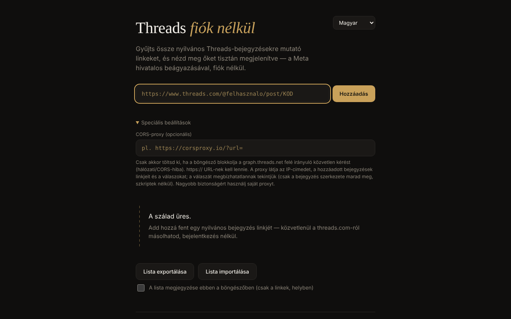

# Threads fără cont

[English](README.md) · [Română](README.ro.md) · [Français](README.fr.md) · [Italiano](README.it.md) · [Español](README.es.md) · [Português](README.pt.md) · [Deutsch](README.de.md) · **Magyar**

**Verzió:** 2.0.0 · **Utolsó frissítés:** 2026-10-26

A felület nyelvei: **Română, English, Français, Italiano, Español, Português (PT), Deutsch, Magyar**

Nyilvános Threads-bejegyzések megjelenítője egyetlen HTML-fájlban: egyedi hivatkozásokat adsz hozzá, és a Meta hivatalos beágyazásán keresztül látod őket megjelenítve, fiók nélkül, 8 nyelven.

**Online alkalmazás:** https://chiuta.github.io/Threads-fara-cont/

## Mi ez

Egy „szál”, amelyet kézzel építesz fel nyilvános Threads-bejegyzésekre mutató hivatkozásokból. Az alkalmazás a Meta oEmbed API-jától (`graph.threads.net/v1.0/oembed`) kéri el a bejegyzést, és megjeleníti az oldalon. A felület román, angol, francia, olasz, spanyol, portugál, német és magyar nyelven létezik. Személyes, nem hivatalos projekt, a Metához semmi köze.

## Funkciók

- Bejegyzések hozzáadása hivatkozással (`threads.com` / `threads.net`, `@felhasznalo/post/KÓD` vagy `t/KÓD` alakban), szigorú ellenőrzéssel és az ismétlődések felismerésével.
- Minden kártyának van eltávolítás gombja; a folyamatban lévő kérések eltávolításkor megszakadnak.
- A lista exportálása (soronként egy hivatkozás, egy szövegmezőben) és importálása: importonként legfeljebb 50 sor, legfeljebb 100 bejegyzés a szálban, korlátozott párhuzamosságú betöltés; a kártyák sorrendje a listáét követi.
- Opcionális „CORS-proxy” mező: csak `https://`, felhasználónév/jelszó nélkül; tartalmazhat `{url}`-t, vagy a végére fűzve megkapja a kódolt oEmbed-URL-t.
- 15 másodperces időkorlát kérésenként, megkülönböztetett hibaüzenetekkel (CORS/hálózat, időtúllépés, érvénytelen proxy, üres válasz).
- Az oEmbed-választ (és a proxyét is) megbízhatatlanként kezeli: egy inert dokumentumba elemzi, és csak a szöveget, valamint a `threads.net`/`threads.com` felé mutató hivatkozásokat tartalmazó `blockquote.text-post-media` marad meg; a szkriptek, az `on*` attribútumok, a `style` és a `javascript:` URL-ek eltávolításra kerülnek.
- Opcionális helyi mentés („A lista megjegyzése ebben a böngészőben”, alapértelmezetten kikapcsolva): csak a hivatkozások maradnak meg, a `localStorage`-ben; a következő látogatáskor megjelenik a „Mentett lista visszaállítása” gomb, és addig nincs hálózati kérés, amíg meg nem nyomod. A kikapcsolás törli a mentett listát.
- Export: a szövegmezőnek mostantól van „Másolás” és „.txt letöltése” gombja; a sikertelen kártyákon van „Újrapróbálás” gomb, „Megnyitás a Threadsen ↗” hivatkozás és „offline” üzenet automatikus újrapróbálkozással újrakapcsolódáskor; nyomtatási stílus (csak a szál nyomtatódik).
- Nyelvválasztó; az alapértelmezett nyelv a böngésző beállításaiból származik.

## Használat

1. Nyisd meg az oldalt, és ha szeretnéd, válaszd ki a nyelvet a jobb felső sarokban.
2. Másold ki egy nyilvános bejegyzés hivatkozását a threads.com-ról.
3. Illeszd be a mezőbe, és nyomd meg a „Hozzáadás” gombot (vagy az Entert). A bejegyzés kártyaként jelenik meg a szálban.
4. Ha hálózati/CORS-hiba jelenik meg, nyisd meg a „Speciális beállításokat”, és add meg egy `https://` CORS-proxyt (lehetőleg a sajátodat).
5. A „Lista exportálása” egy szövegmezőben mutatja a hivatkozásokat; másold őket egy fájlba. Újratöltésükhöz „Lista importálása”, illeszd be a hivatkozásokat, majd „Import megerősítése”.
6. Egy kártya eltávolításához nyomd meg rajta a × jelet.

## Adatvédelem és hálózat

**Fiók nélkül ≠ követés nélkül.**

- Tárolás: alapértelmezetten az alkalmazás nem használ `localStorage`-et, `sessionStorage`-et, sütiket vagy IndexedDB-t; a lista csak a lap memóriájában létezik, és te mented az exportálással. Csak ha bejelölöd a „A lista megjegyzése ebben a böngészőben” lehetőséget, íródnak a hivatkozások (nem a bejegyzések tartalma) a `localStorage`-be (`tfc_keep`, `tfc_list`), és a jelölés megszüntetésekor törlődnek.
- Felvett kapcsolatú gazdagépek, csak bejegyzés hozzáadásakor: `graph.threads.net` (az oEmbed-kérés; vagy az általad beállított proxy) és `www.threads.net` (az `embed.js` szkript, a Meta által ellenőrzött harmadik féltől származó kód, a kódban rögzített címről töltve, soha nem a válaszból). Az `embed.js` ezután iframe-eket hoz létre a Threads-domainek felé.
- A Meta látja az IP-címedet, a böngésződ adatait és a megtekintett bejegyzéseket. Az általad beállított proxy látja az IP-det, a hozzáadott hivatkozásokat és a válaszokat.
- Az oldalon CSP-szabályzat van (`meta http-equiv`), amely a szkripteket a saját szkriptre (SHA-256-hash azonosítja, `'unsafe-inline'` nélkül) és a `threads.net`/`threads.com`-ra, a kereteket pedig a Threads-domainekre korlátozza. A valódi `embed.js`-sel való kompatibilitást a fejlesztői környezetből nem lehetett tesztelni (nincs hálózati hozzáférés).
- Az alkalmazásnak nincs analitikája, és a fentieken kívül sehová nem küld adatot. Nem kér böngészőengedélyeket.

## Korlátok és figyelmeztetések

- Az az állítás, hogy a Threads oEmbed 2026. június 15. óta token nélkül működik, a Meta bejelentéséből származik („Tokenless access to Meta oEmbed APIs”, a Meta fejlesztői blogja, 2026.06.15.); a régi dokumentáció még tokent kér, a korlátok és feltételek eltérhetnek — ellenőrizd a Meta dokumentációját.
- A Meta feltételei a beágyazást csak megjelenítésre engedik; az alkalmazás nem nyeri ki és nem őrzi meg a bejegyzések tartalmát.
- Nem tudja automatikusan listázni egy profil bejegyzéseit (a Meta erre nem kínál nyilvános API-t).
- Ha bezárod vagy újratöltöd az oldalt úgy, hogy bejegyzések vannak a szálban, a böngésző megerősítést kér (a lista csak akkor mentődik, ha bejelölted a helyi mentést; egyébként használd a „Lista exportálása” funkciót).
- A privát, korhatáros vagy földrajzilag blokkolt bejegyzések nem jelennek meg.
- A böngésző blokkolhatja a közvetlen kérést (CORS); ilyenkor proxy szükséges, a fent leírt adatvédelmi következményekkel.
- Ha jogellenes vagy káros tartalomba ütközöl, jelentsd a Metának; az alkalmazás semmit nem moderál.

## Helyi / offline futtatás

Töltsd le az `index.html` fájlt, és nyisd meg egy böngészőben. Internet nélkül egyetlen bejegyzés sem tölthető be (az alkalmazás az internetes tartalomhoz létezik); a felület, az ellenőrzés és az import/export helyben működik.

## Előzmények / Changelog

### 1.2.3 — 2026-10-22

fff-kit 1.1.4: érintési célok és minimális szövegméret.

### 1.2.2 — 2026-10-22
- fff-kit 1.1.2: PBKDF2 600 000 iterációval, clickjacking elleni védelem

### 1.2.1 — 2026-10-22
- Click-to-load a harmadik fél szkriptjéhez: a Metától lekért bejegyzésszöveg egyszerű szövegként és hivatkozásokként jelenik meg; a Meta embed.js-e csak a „Megjelenítés a Meta beágyazásával” gomb után töltődik be a threads.net-ről.
- Új „.json letöltése” export bejegyzésenként URL-lel, szerzővel és hozzáadás dátumával.
- Mobil: nincs 12 px alatti szöveg, az érintési célpontok legalább 24 px-esek (WCAG 2.5.8).

### 1.1.0 — 2026-10-14
- Biztonsági mentés és adatcímkézés (fff-kit).

### 2026. október 12. — 1.0.0 verzió
- 1.0.0 — 2026-10-12: a verzió és az utolsó frissítés dátuma megjelenik az alkalmazásban

### 2026. október 11. (harmadik menet)
- Sikertelen kártyák: megkülönböztetett „offline vagy” üzenet (amikor a böngésző a kapcsolat hiányát jelzi, 7 nyelven), automatikus újrapróbálkozás újrakapcsolódáskor és „Megnyitás a Threadsen ↗” hivatkozás az eredeti bejegyzésre (csak kattintásra nyílik meg), hogy a beágyazás nélkül is hasznos maradjon. CSP: hash újraszámolva.

### 2026. október 11. (második menet)
- A hivatkozáslista opcionális helyi mentése (alapértelmezetten kikapcsolva) kérésre történő visszaállítással; export „Másolás”/„.txt letöltése” gombbal; „Újrapróbálás” a sikertelen kártyákon; nyomtatási stílus; új szövegek mind a 7 nyelven. CSP: a szkript hash-e újraszámolva.

### 2026. október 11.
- Hozzáférhetőség: a tartalom `<main>`-be van foglalva; az axe-core 0 szabálysértést jelez 1280 és 360 px mellett.
- A lista már nem vész el váratlanul: a lap bezárásakor/újratöltésekor, ha bejegyzések vannak a szálban, a böngésző megerősítést kér.
- CSP: a `script-src` SHA-256-hasht használ az `'unsafe-inline'` helyett.
- README: a Meta tokenmentes oEmbedről szóló bejelentése (2026.06.15.) ismét megerősítve.

**2026.10.11-én ellenőrzött források:** developers.facebook.com — „Tokenless access to Meta oEmbed APIs” (2026.06.15.): Threads oEmbed token nélkül, a korlátok esetleg eltérőek.

## Licenc

MIT — lásd a `LICENSE` fájlt.

## Szerző

Alexio — Alexandru-Ionuț Chiuță, kapcsolat: alexio@trom.tf

## Összefoglaló

A Threads fără cont („Threads fiók nélkül”) egyetlen fájlból álló megjelenítő nyilvános Threads-bejegyzésekhez, 8 nyelven. Egyes bejegyzések hivatkozásait illeszted be; lekéri a Meta oEmbedjét (opcionálisan a saját HTTPS CORS-proxyd segítségével), és megtisztított beágyazást jelenít meg. Az oEmbed-választ soha nem szúrja be nyersen. Nincs fiók, nincs analitika, nincs böngészőtárolás, de a Meta látja az IP-det és a megtekintett bejegyzéseket, és betölti a saját embed.js-ét. Licenc: MIT (lásd LICENSE).
