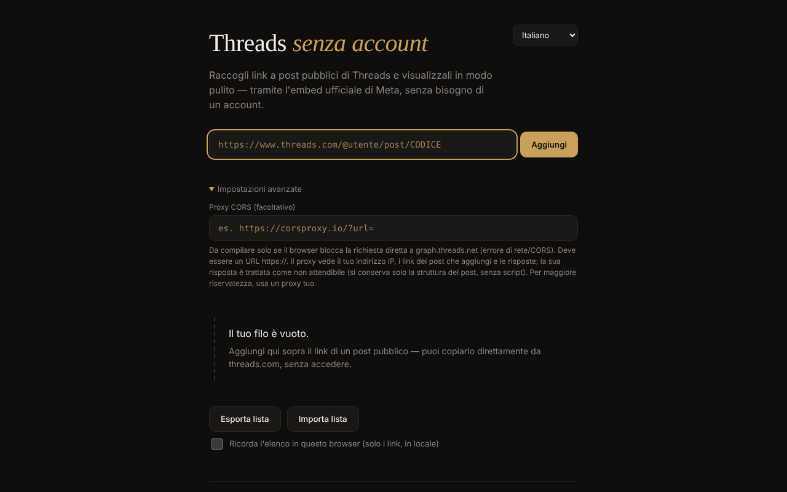

# Threads fără cont

[English](README.md) · [Română](README.ro.md) · [Français](README.fr.md) · **Italiano** · [Español](README.es.md) · [Português](README.pt.md) · [Deutsch](README.de.md) · [Magyar](README.hu.md)

**Versione:** 1.2.2 · **Ultimo aggiornamento:** 2026-10-22

Lingue dell'interfaccia: **Română, English, Français, Italiano, Español, Português (PT), Deutsch, Magyar**

Visualizzatore di post pubblici di Threads in un unico file HTML: aggiungi link singoli e li vedi mostrati tramite l'embed ufficiale di Meta, senza account, in 8 lingue.

**Applicazione online:** https://chiuta.github.io/Threads-fara-cont/

## Che cos'è

Un «filo» costruito a mano da link a post pubblici di Threads. L'app richiede il post all'API oEmbed di Meta (`graph.threads.net/v1.0/oembed`) e lo mostra nella pagina. L'interfaccia esiste in rumeno, inglese, francese, italiano, spagnolo, portoghese, tedesco e ungherese. È un progetto personale, non ufficiale, senza alcun legame con Meta.

## Funzioni

- Aggiunta di post tramite link (`threads.com` / `threads.net`, nella forma `@utente/post/CODICE` o `t/CODICE`), con validazione rigorosa e rilevamento dei duplicati.
- Ogni scheda ha un pulsante di rimozione; le richieste in corso vengono annullate alla rimozione.
- Esportazione della lista (un link per riga, in un'area di testo) e importazione: massimo 50 righe per importazione, massimo 100 post nel filo, caricamento con concorrenza limitata; l'ordine delle schede rispetta l'ordine della lista.
- Campo facoltativo «Proxy CORS»: solo `https://`, senza utente/password; può contenere `{url}` oppure riceve l'URL oEmbed codificato in coda.
- Timeout di 15 secondi per richiesta, con messaggi di errore distinti (CORS/rete, timeout, proxy non valido, risposta vuota).
- La risposta oEmbed (e quella del proxy) è trattata come non attendibile: viene analizzata in un documento inerte e si conserva solo il `blockquote.text-post-media` con testo e link verso `threads.net`/`threads.com`; script, attributi `on*`, `style` e URL `javascript:` vengono rimossi.
- Salvataggio locale facoltativo («Ricorda la lista in questo browser», disattivato per impostazione predefinita): si conservano solo i link, in `localStorage`; alla visita successiva compare il pulsante «Ripristina la lista salvata», senza alcuna richiesta di rete finché non lo premi. La disattivazione elimina la lista salvata.
- Esportazione: l'area di testo ha ora i pulsanti «Copia» e «Scarica .txt»; le schede non riuscite hanno un pulsante «Riprova», un link «Apri su Threads ↗» e un messaggio «offline» con nuovo tentativo automatico alla riconnessione; stile di stampa (si stampa solo il filo).
- Selettore di lingua; la lingua predefinita proviene dalle impostazioni del browser.

## Come si usa

1. Apri la pagina e, se vuoi, scegli la lingua dall'angolo in alto a destra.
2. Copia il link di un post pubblico da threads.com.
3. Incollalo nel campo e premi «Aggiungi» (o Invio). Il post compare come scheda nel filo.
4. Se compare un errore di rete/CORS, apri «Impostazioni avanzate» e inserisci un proxy CORS `https://` (meglio uno tuo).
5. «Esporta la lista» mostra i link in un'area di testo; copiali in un file. Per ricaricarli, «Importa la lista», incolla i link e «Conferma l'importazione».
6. Premi × su una scheda per rimuoverla.

## Riservatezza e rete

**Senza account ≠ senza tracciamento.**

- Archiviazione: per impostazione predefinita l'app non usa `localStorage`, `sessionStorage`, cookie né IndexedDB; la lista esiste solo nella memoria della scheda e la salvi tu tramite l'esportazione. Solo se spunti «Ricorda la lista in questo browser» i link (non il contenuto dei post) vengono scritti in `localStorage` (`tfc_keep`, `tfc_list`) e vengono eliminati quando togli la spunta.
- Host contattati, solo quando aggiungi un post: `graph.threads.net` (la richiesta oEmbed; oppure il proxy che configuri tu) e `www.threads.net` (lo script `embed.js`, codice di terze parti controllato da Meta, caricato dall'indirizzo fisso nel codice, mai dalla risposta). `embed.js` crea poi iframe verso i domini Threads.
- Meta vede il tuo indirizzo IP, i dati del browser e i post che visualizzi. Un proxy configurato da te vede il tuo IP, i link aggiunti e le risposte.
- La pagina contiene una politica CSP (`meta http-equiv`) che limita gli script al proprio script (identificato da un hash SHA-256, senza `'unsafe-inline'`) e a `threads.net`/`threads.com`, e i frame ai domini Threads. La compatibilità con il vero `embed.js` non ha potuto essere testata dall'ambiente di sviluppo (senza accesso alla rete).
- L'app non ha analitica e non invia dati altrove oltre a quanto indicato. Non richiede permessi del browser.

## Limiti e avvertenze

- L'affermazione che l'oEmbed di Threads funziona senza token dal 15 giugno 2026 proviene dall'annuncio di Meta («Tokenless access to Meta oEmbed APIs», blog degli sviluppatori di Meta, 15.06.2026); la vecchia documentazione richiede ancora un token, e limiti e condizioni possono differire — verifica la documentazione di Meta.
- I termini di Meta consentono l'embed solo per la visualizzazione; l'app non estrae né conserva il contenuto dei post.
- Non può elencare automaticamente i post di un profilo (Meta non offre un'API pubblica per questo).
- Se chiudi o ricarichi la pagina con post nel filo, il browser chiede conferma (la lista non viene salvata a meno che tu abbia spuntato il salvataggio locale; altrimenti usa «Esporta la lista»).
- I post privati, con limiti di età o bloccati geograficamente non vengono mostrati.
- Il browser può bloccare la richiesta diretta (CORS); allora serve un proxy, con le implicazioni di riservatezza sopra indicate.
- Se ti imbatti in contenuti illegali o dannosi, segnalali a Meta; l'app non modera nulla.

## Esecuzione locale / offline

Scarica `index.html` e aprilo in un browser. Senza internet non si può caricare nessun post (l'app esiste per contenuti da internet); l'interfaccia, la validazione e l'importazione/esportazione funzionano in locale.

## Cronologia / Changelog

### 1.2.2 — 2026-10-22
- fff-kit 1.1.2: PBKDF2 con 600.000 iterazioni, protezione anti-clickjacking

### 1.2.1 — 2026-10-22
- Click-to-load per lo script di terzi: il testo del post ottenuto da Meta appare come testo e link semplici; embed.js di Meta viene caricato da threads.net solo dopo «Mostra con l'embed di Meta».
- Nuova esportazione «Scarica .json» con URL, autore e data di aggiunta per ogni post.
- Mobile: nessun testo sotto i 12 px e aree tattili di almeno 24 px (WCAG 2.5.8).

### 1.1.0 — 2026-10-14
- Copia di sicurezza ed etichettatura dei dati (fff-kit).

### 12 ottobre 2026 — versione 1.0.0
- 1.0.0 — 2026-10-12: la versione e la data dell'ultimo aggiornamento sono mostrate nell'app

### 11 ottobre 2026 (terzo passaggio)
- Schede non riuscite: messaggio distinto «sei offline» (quando il browser segnala l'assenza di connessione, in 7 lingue), nuovo tentativo automatico alla riconnessione e link «Apri su Threads ↗» al post originale (si apre solo al clic), così resta utile anche senza embed. CSP: hash ricalcolato.

### 11 ottobre 2026 (secondo passaggio)
- Salvataggio locale facoltativo della lista di link (disattivato per impostazione predefinita) con ripristino su richiesta; esportazione con «Copia»/«Scarica .txt»; «Riprova» sulle schede non riuscite; stile di stampa; nuovi testi in tutte le 7 lingue. CSP: hash dello script ricalcolato.

### 11 ottobre 2026
- Accessibilità: il contenuto è racchiuso in `<main>`; axe-core segnala 0 violazioni a 1280 e 360 px.
- La lista non si perde più inaspettatamente: alla chiusura/ricarica della scheda con post nel filo, il browser chiede conferma.
- CSP: `script-src` usa un hash SHA-256 invece di `'unsafe-inline'`.
- README: l'annuncio di Meta sull'oEmbed senza token (15.06.2026) è stato riconfermato.

**Fonti verificate l'11.10.2026:** developers.facebook.com — «Tokenless access to Meta oEmbed APIs» (15.06.2026): oEmbed di Threads senza token, limiti eventualmente diversi.

## Licenza

MIT — vedi il file `LICENSE`.

## Autore

Alexio — Alexandru-Ionuț Chiuță, contatto: alexio@trom.tf

## Riepilogo

Threads fără cont («Threads senza account») è un visualizzatore in un unico file per post pubblici di Threads, in 8 lingue. Incolli link di singoli post; recupera l'oEmbed di Meta (eventualmente tramite un tuo proxy CORS HTTPS) e mostra un embed ripulito. La risposta oEmbed non viene mai iniettata così com'è. Nessun account, nessuna analitica, nessuna archiviazione nel browser, ma Meta vede il tuo IP e i post che visualizzi, e carica il proprio embed.js. Licenza: MIT (vedi LICENSE).
