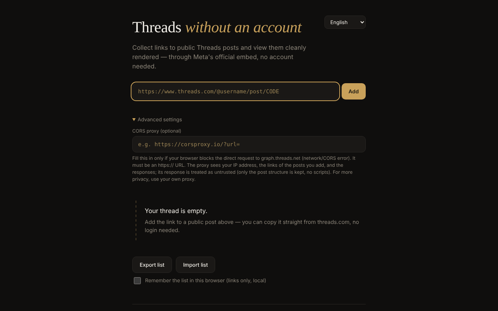

# Threads fără cont

**English** · [Română](README.ro.md) · [Français](README.fr.md) · [Italiano](README.it.md) · [Español](README.es.md) · [Português](README.pt.md) · [Deutsch](README.de.md) · [Magyar](README.hu.md)

**Version:** 2.1.0 · **Last updated:** 2026-10-27

**Status:** stable. **Offline:** no — posts load from Meta (graph.threads.net, embed.js) only when you add them; the interface, import/export and the local archive work without internet.

Interface languages: **Română, English, Français, Italiano, Español, Português (PT), Deutsch, Magyar**

A viewer for public Threads posts in a single HTML file: you add individual links and see them rendered through Meta's official embed, with no account, in 8 languages.

**Live app:** https://chiuta.github.io/Threads-fara-cont/

## What it is

A "thread" built by hand from links to public Threads posts. The app requests the post from Meta's oEmbed API (`graph.threads.net/v1.0/oembed`) and displays it in the page. The interface exists in Romanian, English, French, Italian, Spanish, Portuguese, German and Hungarian. It is a personal, unofficial project, unrelated to Meta.

## Features

- Adding posts by link (`threads.com` / `threads.net`, in the form `@user/post/CODE` or `t/CODE`), with strict validation and duplicate detection.
- Each card has a remove button; requests in progress are cancelled on removal.
- List export (one link per line, in a text area) and import: at most 50 lines per import, at most 100 posts in the thread, loading with limited concurrency; the order of the cards follows the order of the list.
- Optional "CORS proxy" field: `https://` only, no username/password; it may contain `{url}` or receives the encoded oEmbed URL appended at the end.
- 15-second timeout per request, with distinct error messages (CORS/network, timeout, invalid proxy, empty response).
- The oEmbed response (and the proxy's) is treated as untrusted: it is parsed into an inert document and only the `blockquote.text-post-media` with text and links to `threads.net`/`threads.com` is kept; scripts, `on*` attributes, `style` and `javascript:` URLs are removed.
- Optional local saving ("Remember the list in this browser", off by default): only the links are kept, in `localStorage`; on the next visit the "Restore saved list" button appears, with no network request until you press it. Turning it off deletes the saved list.
- Export: the text area now has "Copy" and "Download .txt" buttons; failed cards have a "Retry" button, an "Open on Threads ↗" link and an "offline" message with automatic retry on reconnection; print style (only the thread is printed).
- Language selector; the default language comes from the browser settings.
- **Thread archive (2.0.0):** paste the text of a public thread and save it locally (only on “Save”, in `localStorage`) with author, link, post date and archive date. Citations in simple / APA 7 / MLA 9 / Chicago, archive search, Markdown export (with frontmatter), archiving links (Wayback, archive.today) and “Check if it still exists” (Meta oEmbed). Nothing is downloaded from Threads.

## How to use

1. Open the page and, if you wish, choose the language from the top-right corner.
2. Copy the link of a public post from threads.com.
3. Paste it into the field and press "Add" (or Enter). The post appears as a card in the thread.
4. If a network/CORS error appears, open "Advanced settings" and fill in an `https://` CORS proxy (preferably your own).
5. "Export list" shows the links in a text area; copy them into a file. To reload them, "Import list", paste the links and "Confirm import".
6. Press × on a card to remove it.

## Optional CORS proxy (2.1.0)

If the browser blocks the direct request to `graph.threads.net` (CORS), you can run **your own** proxy. [`proxy/cloudflare-worker.js`](proxy/cloudflare-worker.js) is a dependency-free Worker (about 60 lines) that forwards **only** `https://graph.threads.net/v1.0/oembed` for Threads post links, answers only to one allowed origin (variable `ALLOWED_ORIGIN`, default `https://chiuta.github.io`), keeps no logs and sends none of your cookies to Meta. In “Advanced settings → CORS proxy” enter `https://your-worker.workers.dev/?url=`.

**Status: experimental.** The logic is tested with a simulated `fetch` (`tests/export-proxy.test.mjs`); it has **not** been deployed or tested on a real Cloudflare account, nor against the live Meta endpoint. A proxy sees your IP and the links you add: run it only if you control it. It is not bundled in `index.html` on purpose (the app stays a single file with no server of ours); the page’s CSP already allows `https:` connections, but not `http://localhost`.

Exports: besides the link list as `.txt` and `.json`, 2.1.0 adds `.md` (one link per line as a Markdown list; the content of the posts is not kept, so it is not exported). The local archive already exported Markdown.

## Privacy and network

**No account ≠ no tracking.**

- Storage: by default the app uses no `localStorage`, `sessionStorage`, cookies or IndexedDB; the list exists only in the tab's memory and you save it yourself through export. Only if you tick "Remember the list in this browser" are the links (not the content of the posts) written to `localStorage` (`tfc_keep`, `tfc_list`), and they are deleted when you untick it.
- Hosts contacted, only when you add a post: `graph.threads.net` (the oEmbed request; or the proxy you configure yourself) and `www.threads.net` (the `embed.js` script, third-party code controlled by Meta, loaded from the fixed address in the code, never from the response). `embed.js` then creates iframes pointing to the Threads domains.
- Meta sees your IP address, your browser data and the posts you view. A proxy configured by you sees your IP, the links added and the responses.
- The page contains a CSP policy (`meta http-equiv`) that limits scripts to its own script (identified by a SHA-256 hash, without `'unsafe-inline'`) and to `threads.net`/`threads.com`, and frames to the Threads domains. Compatibility with the real `embed.js` could not be tested from the development environment (no network access).
- The app has no analytics and sends data nowhere other than as described above. It asks for no browser permissions.

## Limits and warnings

- The claim that Threads oEmbed works without a token since 15 June 2026 comes from Meta's announcement ("Tokenless access to Meta oEmbed APIs", Meta developer blog, 15.06.2026); the old documentation still requires a token, and the limits and conditions may differ — check Meta's documentation.
- Meta's terms allow the embed for display only; the app does not extract or keep the content of the posts.
- It cannot automatically list a profile's posts (Meta provides no public API for this).
- If you close or reload the page with posts in the thread, the browser asks for confirmation (the list is not saved unless you ticked local saving; otherwise use "Export list").
- Private, age-restricted or geo-blocked posts are not displayed.
- The browser may block the direct request (CORS); a proxy is then needed, with the privacy implications above.
- If you come across illegal or harmful content, report it to Meta; the app moderates nothing.

## Running locally / offline

Download `index.html` and open it in a browser. Without internet no post can be loaded (the app exists for content from the internet); the interface, validation and import/export work locally.

## History / Changelog

### 2.1.0 — 2026-10-27
- “Download .md” for the link list, optional `proxy/cloudflare-worker.js` (experimental), status/offline lines, `CHANGELOG.md`. Previously: v2.0.0.

### 1.2.3 — 2026-10-22

fff-kit 1.1.4: touch targets and minimum text size.

### 1.2.2 — 2026-10-22
- fff-kit 1.1.2: PBKDF2 600,000 iterations, anti-clickjacking protection

### 1.2.1 — 2026-10-22
- Click-to-load for the third-party script: the post text fetched from Meta is shown as plain text and links; Meta's embed.js is loaded from threads.net only after you press "Show with the Meta embed".
- New "Download .json" export with URL, author and date added for each post.
- Mobile: no text below 12 px and touch targets of at least 24 px (WCAG 2.5.8).

### 1.1.0 — 2026-10-14
- Backup and data labelling (fff-kit).

### 12 October 2026 — version 1.0.0
- 1.0.0 — 2026-10-12: the version and the date of the last update are displayed in the app

### 11 October 2026 (third pass)
- Failed cards: distinct "you are offline" message (when the browser reports no connection, in 7 languages), automatic retry on reconnection and the "Open on Threads ↗" link to the original post (opened only on click), so that it stays useful even without the embed. CSP: hash recalculated.

### 11 October 2026 (second pass)
- Optional local saving of the link list (off by default) with restoration on request; export with "Copy"/"Download .txt"; "Retry" on failed cards; print style; new texts in all 7 languages. CSP: script hash recalculated.

### 11 October 2026
- Accessibility: the content is wrapped in `<main>`; axe-core reports 0 violations at 1280 and 360 px.
- The list is no longer lost unexpectedly: when closing/reloading the tab with posts in the thread, the browser asks for confirmation.
- CSP: `script-src` uses a SHA-256 hash instead of `'unsafe-inline'`.
- README: Meta's announcement about oEmbed without a token (15.06.2026) reconfirmed.

**Sources verified on 11.10.2026:** developers.facebook.com — "Tokenless access to Meta oEmbed APIs" (15.06.2026): Threads oEmbed without a token, limits possibly different.

## License

MIT — see the `LICENSE` file.

## Author

Alexio — Alexandru-Ionuț Chiuță, contact: alexio@trom.tf

## Summary

Threads fără cont ("Threads without an account") is a single-file viewer for public Threads posts, in 8 languages. You paste individual post links; it fetches Meta's oEmbed (optionally via your own HTTPS CORS proxy) and renders a sanitised embed. The oEmbed response is never injected raw. No account, no analytics, no browser storage, but Meta sees your IP and the posts you view, and loads its own embed.js. License: MIT (see LICENSE).
