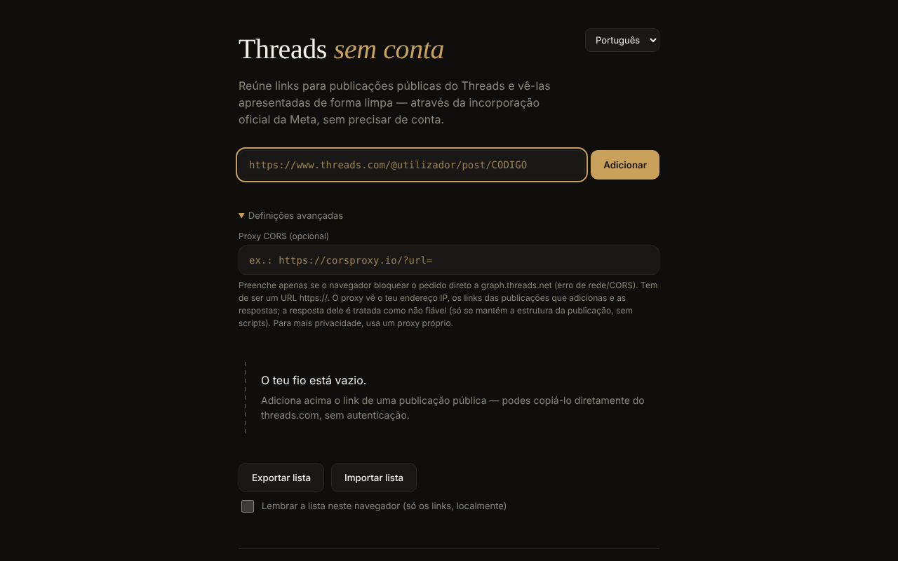

# Threads fără cont

[English](README.md) · [Română](README.ro.md) · [Français](README.fr.md) · [Italiano](README.it.md) · [Español](README.es.md) · **Português** · [Deutsch](README.de.md) · [Magyar](README.hu.md)

**Versão:** 1.2.0 · **Última atualização:** 2026-10-19

Idiomas da interface: **Română, English, Français, Italiano, Español, Português (PT), Deutsch, Magyar**

Visualizador de publicações públicas do Threads num único ficheiro HTML: adiciona ligações individuais e vê-as apresentadas através do embed oficial da Meta, sem conta, em 8 idiomas.

**Aplicação online:** https://chiuta.github.io/Threads-fara-cont/

## O que é

Um «fio» construído manualmente a partir de ligações para publicações públicas do Threads. A aplicação pede a publicação à API oEmbed da Meta (`graph.threads.net/v1.0/oembed`) e apresenta-a na página. A interface existe em romeno, inglês, francês, italiano, espanhol, português, alemão e húngaro. É um projeto pessoal, não oficial, sem qualquer ligação à Meta.

## Funcionalidades

- Adição de publicações por ligação (`threads.com` / `threads.net`, na forma `@utilizador/post/CÓDIGO` ou `t/CÓDIGO`), com validação rigorosa e deteção de duplicados.
- Cada cartão tem um botão de remoção; os pedidos em curso são cancelados ao remover.
- Exportação da lista (uma ligação por linha, numa área de texto) e importação: no máximo 50 linhas por importação, no máximo 100 publicações no fio, carregamento com concorrência limitada; a ordem dos cartões respeita a ordem da lista.
- Campo opcional «Proxy CORS»: apenas `https://`, sem utilizador/palavra-passe; pode conter `{url}` ou recebe no fim o URL oEmbed codificado.
- Tempo limite de 15 segundos por pedido, com mensagens de erro distintas (CORS/rede, tempo limite, proxy inválido, resposta vazia).
- A resposta oEmbed (e a do proxy) é tratada como não fiável: é analisada num documento inerte e conserva-se apenas o `blockquote.text-post-media` com texto e ligações para `threads.net`/`threads.com`; os scripts, os atributos `on*`, `style` e os URL `javascript:` são removidos.
- Gravação local opcional («Lembrar a lista neste navegador», desativada por predefinição): conservam-se apenas as ligações, no `localStorage`; na visita seguinte aparece o botão «Restaurar a lista guardada», sem qualquer pedido de rede até o premir. Desativar elimina a lista guardada.
- Exportação: a área de texto tem agora os botões «Copiar» e «Descarregar .txt»; os cartões falhados têm um botão «Tentar novamente», uma ligação «Abrir no Threads ↗» e uma mensagem «offline» com nova tentativa automática ao reconectar; estilo de impressão (só o fio é impresso).
- Seletor de idioma; o idioma predefinido vem das definições do navegador.

## Como se utiliza

1. Abra a página e, se quiser, escolha o idioma no canto superior direito.
2. Copie a ligação de uma publicação pública de threads.com.
3. Cole-a no campo e prima «Adicionar» (ou Enter). A publicação aparece como um cartão no fio.
4. Se surgir um erro de rede/CORS, abra «Definições avançadas» e preencha um proxy CORS `https://` (de preferência um seu).
5. «Exportar a lista» mostra as ligações numa área de texto; copie-as para um ficheiro. Para as recarregar, «Importar a lista», cole as ligações e «Confirmar importação».
6. Prima × num cartão para o remover.

## Privacidade e rede

**Sem conta ≠ sem rastreio.**

- Armazenamento: por predefinição a aplicação não utiliza `localStorage`, `sessionStorage`, cookies nem IndexedDB; a lista existe apenas na memória do separador e é o utilizador que a guarda através da exportação. Só se assinalar «Lembrar a lista neste navegador» é que as ligações (não o conteúdo das publicações) são escritas no `localStorage` (`tfc_keep`, `tfc_list`), sendo eliminadas ao desassinalar.
- Anfitriões contactados, apenas ao adicionar uma publicação: `graph.threads.net` (o pedido oEmbed; ou o proxy que configurar) e `www.threads.net` (o script `embed.js`, código de terceiros controlado pela Meta, carregado a partir do endereço fixo no código, nunca a partir da resposta). O `embed.js` cria depois iframes para os domínios do Threads.
- A Meta vê o seu endereço IP, os dados do navegador e as publicações que visualiza. Um proxy configurado por si vê o seu IP, as ligações adicionadas e as respostas.
- A página contém uma política CSP (`meta http-equiv`) que limita os scripts ao script próprio (identificado por um hash SHA-256, sem `'unsafe-inline'`) e a `threads.net`/`threads.com`, e as frames aos domínios do Threads. A compatibilidade com o `embed.js` real não pôde ser testada a partir do ambiente de desenvolvimento (sem acesso à rede).
- A aplicação não tem análise de utilização e não envia dados para mais lado nenhum além do descrito. Não pede permissões ao navegador.

## Limites e avisos

- A afirmação de que o oEmbed do Threads funciona sem token desde 15 de junho de 2026 provém do anúncio da Meta («Tokenless access to Meta oEmbed APIs», blogue para programadores da Meta, 15.06.2026); a documentação antiga ainda exige token, e os limites e condições podem diferir — consulte a documentação da Meta.
- Os termos da Meta permitem o embed apenas para apresentação; a aplicação não extrai nem conserva o conteúdo das publicações.
- Não consegue listar automaticamente as publicações de um perfil (a Meta não oferece API pública para isso).
- Se fechar ou recarregar a página com publicações no fio, o navegador pede confirmação (a lista não é guardada a menos que tenha assinalado a gravação local; caso contrário, utilize «Exportar a lista»).
- As publicações privadas, com restrição de idade ou bloqueadas geograficamente não são apresentadas.
- O navegador pode bloquear o pedido direto (CORS); nesse caso é necessário um proxy, com as implicações de privacidade acima descritas.
- Se encontrar conteúdo ilegal ou prejudicial, denuncie-o à Meta; a aplicação não modera nada.

## Execução local / offline

Descarregue `index.html` e abra-o num navegador. Sem internet não é possível carregar nenhuma publicação (a aplicação existe para conteúdo da internet); a interface, a validação e a importação/exportação funcionam localmente.

## Histórico / Changelog

### 1.1.0 — 2026-10-14
- Cópia de segurança e etiquetagem de dados (fff-kit).

### 12 de outubro de 2026 — versão 1.0.0
- 1.0.0 — 2026-10-12: a versão e a data da última atualização são apresentadas na aplicação

### 11 de outubro de 2026 (terceira passagem)
- Cartões falhados: mensagem distinta «está offline» (quando o navegador indica a falta de ligação, em 7 idiomas), nova tentativa automática ao reconectar e ligação «Abrir no Threads ↗» para a publicação original (abre-se apenas ao clicar), para que continue útil mesmo sem o embed. CSP: hash recalculado.

### 11 de outubro de 2026 (segunda passagem)
- Gravação local opcional da lista de ligações (desativada por predefinição) com restauro a pedido; exportação com «Copiar»/«Descarregar .txt»; «Tentar novamente» nos cartões falhados; estilo de impressão; textos novos nos 7 idiomas. CSP: hash do script recalculado.

### 11 de outubro de 2026
- Acessibilidade: o conteúdo está envolvido em `<main>`; o axe-core reporta 0 violações a 1280 e 360 px.
- A lista já não se perde inesperadamente: ao fechar/recarregar o separador com publicações no fio, o navegador pede confirmação.
- CSP: `script-src` utiliza um hash SHA-256 em vez de `'unsafe-inline'`.
- README: o anúncio da Meta sobre oEmbed sem token (15.06.2026) foi reconfirmado.

**Fontes verificadas em 11.10.2026:** developers.facebook.com — «Tokenless access to Meta oEmbed APIs» (15.06.2026): oEmbed do Threads sem token, limites possivelmente diferentes.

## Licença

MIT — ver o ficheiro `LICENSE`.

## Autor

Alexio — Alexandru-Ionuț Chiuță, contacto: alexio@trom.tf

## Resumo

Threads fără cont («Threads sem conta») é um visualizador de um único ficheiro para publicações públicas do Threads, em 8 idiomas. Cola ligações de publicações individuais; obtém o oEmbed da Meta (opcionalmente através de um proxy CORS HTTPS seu) e apresenta um embed higienizado. A resposta oEmbed nunca é injetada tal como está. Sem conta, sem análise de utilização, sem armazenamento no navegador, mas a Meta vê o seu IP e as publicações que visualiza, e carrega o seu próprio embed.js. Licença: MIT (ver LICENSE).
