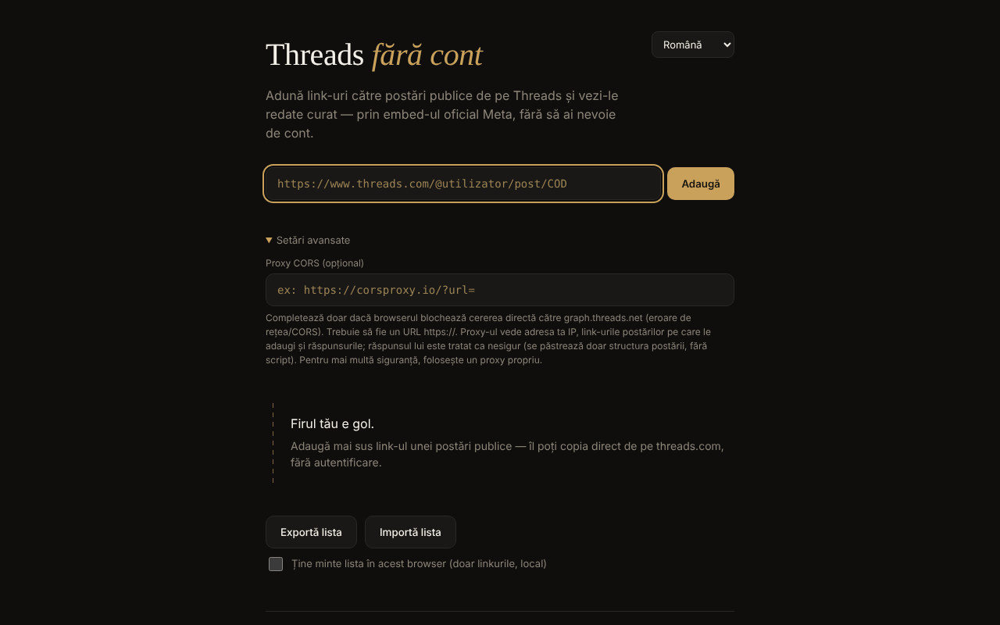

# Threads fără cont

[English](README.md) · **Română** · [Français](README.fr.md) · [Italiano](README.it.md) · [Español](README.es.md) · [Português](README.pt.md) · [Deutsch](README.de.md) · [Magyar](README.hu.md)

**Versiune:** 1.2.0 · **Ultima actualizare:** 2026-10-19

Limbile interfeței: **Română, English, Français, Italiano, Español, Português (PT), Deutsch, Magyar**

Vizualizator de postări publice Threads într-un singur fișier HTML: adaugi link-uri individuale și le vezi redate prin embed-ul oficial Meta, fără cont, în 8 limbi.

**Live:** https://chiuta.github.io/Threads-fara-cont/

## Ce este

Un „fir" construit manual din link-uri către postări Threads publice. Aplicația cere postarea de la API-ul oEmbed al Meta (`graph.threads.net/v1.0/oembed`) și o afișează în pagină. Interfața există în română, engleză, franceză, italiană, spaniolă, portugheză, germană și maghiară. Este un proiect personal, neoficial, fără legătură cu Meta.

## Funcții

- Adăugare de postări după link (`threads.com` / `threads.net`, forma `@utilizator/post/COD` sau `t/COD`), cu validare strictă și detectarea duplicatelor.
- Fiecare card are buton de eliminare; cererile în curs se anulează la eliminare.
- Export (un link pe linie, într-o zonă de text) și import de listă: maximum 50 de linii per import, maximum 100 de postări în fir, încărcare cu concurență limitată; ordinea cardurilor respectă ordinea listei.
- Câmp opțional „Proxy CORS": doar `https://`, fără utilizator/parolă; poate conține `{url}` sau primește URL-ul oEmbed codat la final.
- Timeout de 15 secunde per cerere, cu mesaje de eroare distincte (CORS/rețea, timeout, proxy invalid, răspuns gol).
- Răspunsul oEmbed (și al proxy-ului) este tratat ca nesigur: se parsează într-un document inert și se păstrează doar `blockquote.text-post-media` cu text și legături către `threads.net`/`threads.com`; scripturile, atributele `on*`, `style` și URL-urile `javascript:` sunt eliminate.
- Salvare locală opțională („Ține minte lista în acest browser”, implicit oprită): se păstrează doar linkurile, în `localStorage`; la următoarea vizită apare butonul „Restaurează lista salvată”, fără nicio cerere de rețea până îl apeși. Dezactivarea șterge lista salvată.
- Export: zona de text are acum butoane „Copiază” și „Descarcă .txt”; cardurile eșuate au buton „Reîncearcă”, legătură „Deschide pe Threads ↗” și mesaj „offline” cu reîncercare automată la reconectare; stil de tipărire (se tipărește doar firul).
- Selector de limbă; limba implicită din setările browserului.

## Manual de utilizare

1. Deschide pagina și, dacă vrei, alege limba din colțul din dreapta sus.
2. Copiază link-ul unei postări publice de pe threads.com.
3. Lipește-l în câmp și apasă „Adaugă" (sau Enter). Postarea apare ca un card în fir.
4. Dacă apare o eroare de rețea/CORS, deschide „Setări avansate" și completează un proxy CORS `https://` (de preferat unul propriu).
5. „Exportă lista" afișează link-urile într-o zonă de text; copiază-le într-un fișier. Pentru a le reîncărca, „Importă lista", lipește link-urile și „Confirmă import".
6. Apasă × pe un card pentru a-l elimina.

## Confidențialitate și rețea

**Fără cont ≠ fără urmărire.**

- Stocare: implicit aplicația nu folosește `localStorage`, `sessionStorage`, cookie-uri sau IndexedDB; lista există doar în memoria filei și o salvezi tu prin export. Doar dacă bifezi „Ține minte lista în acest browser”, linkurile (nu conținutul postărilor) se scriu în `localStorage` (`tfc_keep`, `tfc_list`) și se șterg la debifare.
- Gazde contactate, doar când adaugi o postare: `graph.threads.net` (cererea oEmbed; sau proxy-ul pe care îl configurezi tu) și `www.threads.net` (scriptul `embed.js`, cod terț controlat de Meta, încărcat din adresa fixă din cod, niciodată din răspuns). `embed.js` creează apoi iframe-uri către domeniile Threads.
- Meta vede adresa ta IP, datele browserului și postările pe care le vizualizezi. Un proxy configurat de tine vede IP-ul tău, link-urile adăugate și răspunsurile.
- Pagina conține o politică CSP (`meta http-equiv`) care limitează scripturile la scriptul propriu (identificat prin hash SHA-256, fără `'unsafe-inline'`) și la `threads.net`/`threads.com` și cadrele la domeniile Threads. Compatibilitatea cu `embed.js` real nu a putut fi testată din mediul de dezvoltare (fără acces la rețea).
- Aplicația nu are analitice și nu trimite date nicăieri în afara celor de mai sus. Nu cere permisiuni ale browserului.

## Limite și avertismente

- Afirmația că oEmbed Threads funcționează fără token din 15 iunie 2026 provine din anunțul Meta („Tokenless access to Meta oEmbed APIs", blogul Meta pentru dezvoltatori, 15.06.2026); documentația veche cere încă token, iar limitele și condițiile pot diferi — verifică documentația Meta.
- Termenii Meta permit embed-ul doar pentru afișare; aplicația nu extrage și nu păstrează conținutul postărilor.
- Nu poate lista automat postările unui profil (Meta nu oferă acest API public).
- Dacă închizi sau reîncarci pagina cu postări în fir, browserul cere confirmare (lista nu se salvează decât dacă ai bifat salvarea locală; altfel folosește „Exportă lista”).
- Postările private, restricționate pe vârstă sau geo-blocate nu se afișează.
- Browserul poate bloca cererea directă (CORS); atunci este nevoie de un proxy, cu implicațiile de confidențialitate de mai sus.
- Dacă dai de un conținut ilegal sau dăunător, raportează-l la Meta; aplicația nu moderează nimic.

## Rulare locală / offline

Descarcă `index.html` și deschide-l în browser. Fără internet nu se poate încărca nicio postare (aplicația există pentru conținut de pe internet); interfața, validarea și importul/exportul funcționează local.

## Istoric / Changelog

### 1.1.0 — 2026-10-14
- Copie de rezervă și etichetare date (fff-kit).

### 12 octombrie 2026 — versiunea 1.0.0
- 1.0.0 — 2026-10-12: versiunea și data ultimei actualizări sunt afișate în aplicație

### 11 octombrie 2026 (a treia trecere)
- Carduri eșuate: mesaj distinct „ești offline” (când browserul raportează lipsa conexiunii, în 7 limbi), reîncercare automată la reconectare și legătura „Deschide pe Threads ↗” către postarea originală (se deschide doar la clic), ca să rămână utilă și fără embed. CSP: hash recalculat.

### 11 octombrie 2026 (a doua trecere)
- Salvare locală opțională a listei de linkuri (implicit oprită) cu restaurare la cerere; export cu „Copiază”/„Descarcă .txt”; „Reîncearcă” pe cardurile eșuate; stil de tipărire; texte noi în toate cele 7 limbi. CSP: hash-ul scriptului recalculat.

### 11 octombrie 2026
- Accesibilitate: conținutul este încadrat în `<main>`; axe-core raportează 0 încălcări la 1280 și 360 px.
- Lista nu se mai pierde pe neașteptate: la închiderea/reîncărcarea filei cu postări în fir, browserul cere confirmare.
- CSP: `script-src` folosește hash SHA-256 în loc de `'unsafe-inline'`.
- README: anunțul Meta despre oEmbed fără token (15.06.2026) reconfirmat.

**Surse verificate la 11.10.2026:** developers.facebook.com — „Tokenless access to Meta oEmbed APIs” (15.06.2026): Threads oEmbed fără token, limite posibil diferite.

## Licență

MIT — vezi fișierul `LICENSE`.

## Autor

Alexio — Alexandru-Ionuț Chiuță, contact: alexio@trom.tf

## English summary

Threads fără cont ("Threads without an account") is a single-file viewer for public Threads posts, in 8 languages. You paste individual post links; it fetches Meta's oEmbed (optionally via your own HTTPS CORS proxy) and renders a sanitised embed. The oEmbed response is never injected raw. No account, no analytics, no browser storage, but Meta sees your IP and the posts you view, and loads its own embed.js. License: MIT (see LICENSE).
